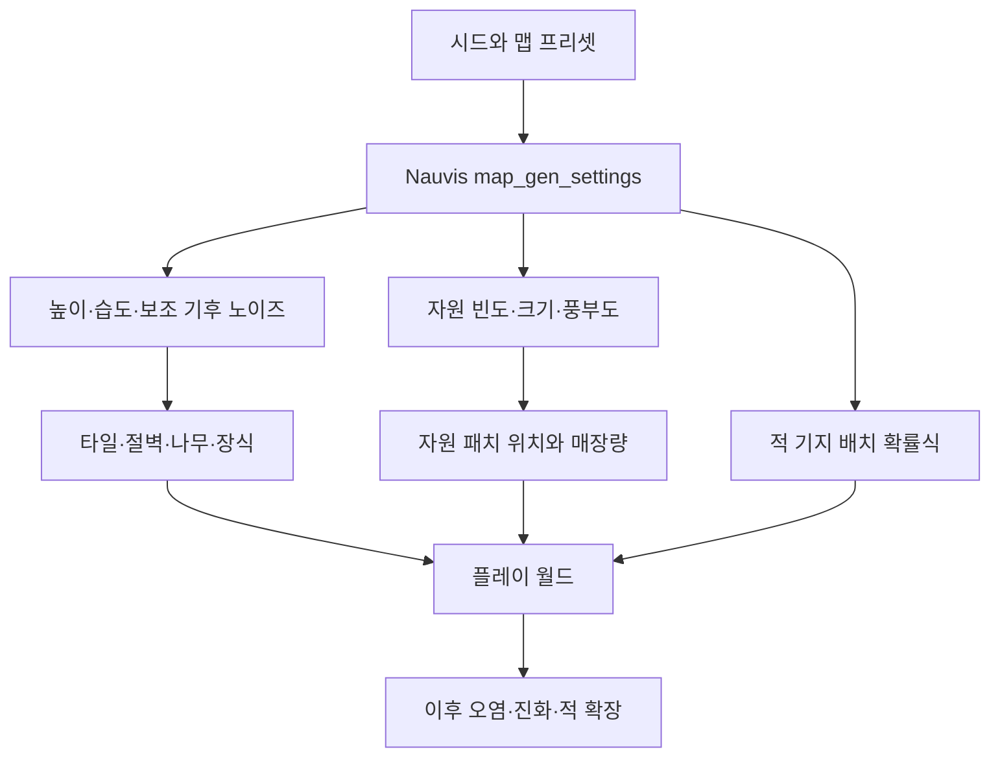

# Factorio 맵 제작·생성 방식

**기본 자유 플레이 맵은 시드와 노이즈 식·자동 배치 규칙으로 생성한다.** 전 세계를 미리 만든 이미지로 저장하는 구조가 아니다. 캠페인·튜토리얼·메뉴 시뮬레이션에는 별도의 저장 맵/시나리오도 있으므로 둘을 구분한다.

## 생성 흐름



설치본은 planet/nauvis 하나다. Nauvis 설정에서 tile·decorative·entity autoplace 목록을 각각 지정한다. 높이, 습도, aux, 절벽 및 자원·적 확률식은 Lua/프로토타입에서 정하고 실제 평가·청크 관리는 게임 엔진이 수행한다.

noise-expression 92개, noise-function 28개를 최종 덤프했다. temperature/moisture/aux/elevation, elevation_lakes/elevation_island, forest_paths, enemy_base_probability, 자원 패치 식 등이 포함된다. 식이 있다는 것과 C++ 노이즈 구현 전체 소스가 있다는 것은 다르다.

## 자원과 시작 지역

`core/lualib/resource-autoplace.lua`가 패치 기반 광상 식을 만든다. base_density, patch_set_name, base_spots_per_km2, seed1, random_probability, has_starting_area_placement 등의 인자를 사용하며, 사용자 control의 frequency/size/richness와 연결한다.

`base/prototypes/entity/resources.lua`는 패치 인덱스를 일정한 순서로 초기화하고 자원 정의를 만든다. 시작 지역용 패치와 일반 패치를 구분한다. 실제 생성 식은 [noise-expression.json](prototypes/noise-expression.json)에 있어 도우미의 기본값·이름만으로 결과를 추정할 필요가 없다.

광상 매장량과 시각적 단계도 다르다. 자원 stages에는 frame_count=8, variation_count=8 및 stage_counts가 존재한다. 이것은 같은 자원을 매장량/변형에 맞춰 그리는 데이터이며 지도 자체가 8프레임 애니메이션이라는 뜻이 아니다.

## 적 배치와 이후 확장

`enemy_base_intensity = clamp(distance, 0, 2400) / 325`가 있고, 반지름은 enemy-base size 제어, 빈도는 frequency 제어와 연결된다. enemy_base_probability는 spot_noise와 basis_noise, 시작 지역 거리 보정 등을 결합한다.

이 최초 배치와 게임 도중의 enemy_expansion은 별개다. 시작할 때 적 기지가 없는 위치에도 이후 확장으로 기지가 생길 수 있다. 평화 모드·적 활성 설정·진화도·시나리오 스크립트 또한 구분해야 한다.

## 저장된 프리셋

`default, rich-resources, marathon, death-world, death-world-marathon, rail-world, ribbon-world, lakes, island` — 총 9개.

- default: 변경을 추가하지 않는 기본 프리셋.
- rich-resources: 자원 richness 변경.
- marathon: 기술 비용 배수 4.
- death-world 계열: 적 빈도/크기·시작 지역·진화·오염 설정 변경.
- rail-world: 자원 빈도 1/3·크기 3 등의 설정과 적 확장 설정 변경.
- ribbon-world/lakes/island: 지도 크기 또는 지형 식 등 별도 구성.

모든 덮어쓰기 원문: [map-gen-presets.json](prototypes/map-gen-presets.json). 일부 대표값을 프리셋 전체로 오해하지 않도록 전체 JSON을 함께 보존했다.

## 실제 생성 검증

게임 공식 CLI를 기존 세이브와 분리한 출력 폴더에서 실행했다. 시드 **42**, Nauvis, 1024×1024, 1픽셀당 1타일, 2스레드 조건이다.

- [기본 프리셋 이미지](map_seed42_default.png)
- [철도 월드 프리셋 이미지](map_seed42_rail-world.png)
- [같은 기본 조건으로 재생성](map_seed42_default_repeat.png)

이 이미지는 임의 그림이 아니라 엔진의 map preview 결과다. 플레이 시점의 스프라이트·그림자가 보이는 스크린샷은 아니다. 기본 조건 반복 이미지의 픽셀 동일성과 프리셋 변경 시 차이는 validation_final.json에서 확인한다. 이 한 표본의 일치가 모든 버전·플랫폼의 결정성을 증명하는 것은 아니다.

```powershell
& 'D:\SteamLibrary\steamapps\common\Factorio\bin\x64\factorio.exe' --config 'D:\99.기타\out_factorio\run\config.ini' --mod-directory 'D:\99.기타\out_factorio\run\mods' --generate-map-preview 'D:\99.기타\out_factorio\map_seed42_default.png' --map-gen-seed 42 --map-preview-size 1024 --preset default --threads 2 --disable-audio
```

## 직접 제작할 때 나눠야 할 것

1. 프리셋·설정: 자원·적·지도 크기 같은 플레이 조건.
2. 타일·엔티티·노이즈 프로토타입: 새 지형과 자동 배치 규칙.
3. 시나리오 control.lua: 시작 지급·목표·승패·이벤트.
4. 저장 맵/에디터 배치: 고정된 퍼즐·튜토리얼·특수 장면.

맵 생성 제어 데이터와 helper Lua는 확보했지만 엔진을 대체하는 독립 맵 생성기를 만든 것은 아니다. 설치본의 저장 ZIP 40개는 CRC 검사와 내부 목록을 완료했고 바이너리 맵 내용의 전 좌표 변환은 별도 작업으로 남겼다.

원문: [Nauvis](prototypes/planet.json), [맵 생성 전체 데이터](analysis/map_generation.json), [resources.lua](raw/data/base/prototypes/entity/resources.lua), [resource-autoplace.lua](raw/data/core/lualib/resource-autoplace.lua), [노이즈 정의](raw/data/base/prototypes/noise-expressions.lua), [설정 예제](raw/data/map-gen-settings.example.json).
