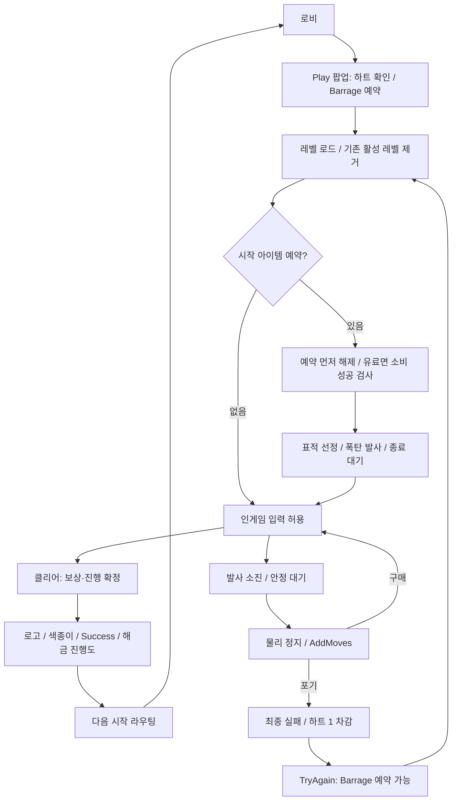

# Royal Smash 시작 아이템·구매·전체 사이클 구현 가이드

2026-09-29 / bmuma7xjy-13, bmumad3u6-14 회신. 원본 `static_physics/libil2cpp.so`와 `il2cpp_dump/dump.cs`, `systems_audit_20260929/asset_values.json` 대조.

> **최신 사용자 지시가 우선:** 구매/광고는 나중에 배선할 수 있도록 세팅만 한다. 아래 원작 구매 흐름은 향후 연결 참고자료이며, 지금 실제 구매·광고 실행을 연결하라는 뜻이 아니다. UI 상태, offer 데이터, 요청 인터페이스 및 성공/취소/실패 콜백 자리만 준비한다. 미연결 상태에서는 코인 차감·지급·자동 선택을 하지 않는다. 보유 아이템 사용 및 시작 예약 구현은 계속한다. 구체적인 연결 계약은 `PURCHASE_AD_WIRING.md`를 따른다.

이 문서는 기존 `items_events_handoff_20260929/ITEMS.md`의 자체 거래 계약과 원작 동작을 구분한다. `[원작값]`은 저장 데이터, `[원작 코드 판독]`은 ARM64 분기 판독, `[원작필드]`는 선언·툴팁, `[자체]`는 이식 설계다. Unity 실행 검증을 이번 문서에서 새로 수행한 것은 아니다. 미확인 항목은 마지막 절에 남겼다.

## 1. 아이템은 사용 시점부터 다르다

|아이템|사용 장소|해금 근거|구매 단위|효과|
|---|---|---|---|---|
|BigBall|인게임 오른쪽|GameplayView 현재 레벨 >=18|resource 3, 1개 1500|장전 공 교체 후 유효 발사|
|Infinite|인게임 왼쪽|GameplayView 현재 레벨 >=22|resource 2, 1개 700|첫 발사부터 3초 무한 발사|
|Barrage|Play / TryAgain 팝업에서 다음 시작 예약|Booster SO UnlockLevel26과 현재 레벨 비교|resource 7, 1개 500|시작 시 자동 표적 선정·최대 3폭탄|

[원작값] 가격 전체 배열은 `booster_assets_source.json`, sharedassets1#2192. SO #2189~2191 원문 raw_hex와 해석값을 함께 제공한다. 3개 묶음 가격이 아니다.

[원작값] Barrage UI는 `level1#5661 UI/Canvas_PlayPopup/Panel/PreBooster_Barrage` 및 `level1#5208 UI/Canvas_TryAgainPopup/Panel/PreBooster_Barrage`에 각각 있다. 재시도 전용이 아니다. 두 곳 m_hideWhenNoneOwned=false. 인게임 일반 2버튼과 같은 탭 슬롯으로 추가하지 않는다.

## 2. 전체 사이클과 구현 경계



그림의 Success→로비 고정 라우팅은 현재 이식의 `[자체]` 연결이다. 원작의 모든 이벤트·튜토리얼 후속 라우팅까지 동일하다고 판정하지 않는다.

기존 조사와 연결할 때 다음 책임을 분리한다.

1. **진입 UI**: 하트가 있는지 검사한다. 시작 자체에서 하트를 차감하지 않는다. Barrage 선택은 예약이며 이 시점에 재고를 쓰지 않는다.
2. **로더**: 옛 레벨을 즉시 비활성화한 뒤 파기하고 새 레벨을 만든다. 이는 lv2 회귀를 고친 `[자체]` 수명 관리 방식이다. 활성 홀더 1을 유지한다. 원본 LoadLevel MoveNext `0x39A4898`에는 ClearAll/ClearBalls, 튜토리얼, RunPreLevelAsync 호출이 있다. 비동기 코드를 주소 순서만으로 실행 순서로 번역하지 않는다.
3. **시작 효과 실행기**: 아래 예약 소비 계약을 실행하고 완료를 기다린다. 플레이어 일반 발사와 별도 경로다.
4. **일반 발사**: 유효 조준 성공 시에만 공통 Fire/VFX/SFX와 발사 수 처리를 한 번 실행한다. BigBall도 공통 경로를 탄다. Barrage 폭탄을 일반 moves 소비 경로에 연결하지 않는다.
5. **종료 판정**: 기존 systems_audit 값으로 안정 대기(min0.5/hold0.5/max2), 이어하기 물리 정지, 최종 패배를 구분한다. 현재 정밀 settle 미이식은 계속 미완료로 표기한다.
6. **결과 정산**: 승리 보상15/40/50과 진행 증가는 연출 전에 확정. 이어하기 가격900/1900/3900은 시도 내 구매 횟수, 추가 발사5/10/15는 이번 실패 순번1/4/8 기준이다. 최종 패배에만 하트 차감. 기존 systems_audit 근거를 유지한다.
7. **결과 연출**: 승리 기준0.75 로고 /1.25 스킵 가능 /1.55 색종이 /3.30 로고 종료. 결과 중복 지급 방지는 시도 ID로 구현한 `[자체]` 안전장치를 유지한다.

## 3. Barrage 예약·무료·실행

[원작 코드 판독] `SetPreLevelArmed 0x3995A8C`: IsPreLevel인 아이템만 예약한다. 무료 모드가 아니면 OwnedCount>=1이 필요하다. 예약은 단일 정적 슬롯이며 활성화 횟수 카운터와 실제 소비 횟수는 다르다.

`RunPreLevelAsync.MoveNext 0x3996450`의 순서:

1. 선택 아이템과 free 플래그를 로컬에 보관.
2. 정적 예약과 free 플래그를 비우고 PreLevelChanged 알림.
3. free=false면 SpendOne. `0x3996664` 실패 분기는 효과 실행을 건너뛴다.
4. 성공/무료 경로에서 used 카운터 및 관련 알림.
5. `RunAtLevelStartAsync(cannon)`을 호출하고 await.

**타깃을 못 찾으면 무소모라는 이전 계약은 원작 판독이 아니다.** 원작은 표적 검색보다 소비가 먼저다. 임의 환불을 넣으려면 `[자체 변경]`으로 분리한다.

[원작필드] PreLevelBoosterToggle의 freeBadge 툴팁은 **해금 튜토리얼의 FREE 데모**를 설명한다. `PreLevelBoosterTutorial.OnEnable 0x3960BA0`에서 free 모드가 설정된다. 실패 N회 보상이라는 근거는 없다. 최초 1회 영속 저장 키와 튜토리얼 재노출 조건까지는 이번 판독으로 확정하지 않았다.

주의: 툴팁에는 TryAgain freeBadge가 null이라고 적혔지만 **실제 level1#5208에는 #391 참조가 저장**되어 있다. 툴팁과 저장 배선이 다르다. 참조가 있고 GO가 켜져 있다는 사실은 런타임 m_tutorialFreeUse=true라는 뜻이 아니다. FREE 표시는 Refresh와 튜토리얼 상태로 제어한다.

`OnDisable 0x39604E0`은 리스너 해제를 수행한다. 팝업 닫기=예약 해제를 이 메서드만으로 구현하지 않는다. 취소·이탈 시 예약 수명은 별도 열린 항목이다.

### 폭탄 실행과 타깃

[원작값] count3, launchStagger0.08, settle0.6, throwSpeed135. Fuse1, MaxFlight3, CastRadius0.12, SurfaceOffset0.1, BlastSpeed2, radius6.5, upwards1, ChainDetonateTnt=false. sides/top/bottom inset 모두1, minSeparation2, deprioritiseExploders=true.

[원작 코드 판독] `BarrageBooster.MoveNext 0x3996F80`: ReleaseSpawnStabilization 후 Pick을 호출한다. 일반 BallController.NotifyMoveUsed 호출 경로가 아니므로 일반 발사 수를 차감시키지 않는다. 타깃 수가 적으면 반드시 3발을 채우는 구조로 바꾸지 않는다. 발사 간 대기, 세션 변경 감지, 생존 폭탄 대기와 제한시간 후 정리, settle 대기를 보존한다.

`BarrageTargeting.Pick 0x382F8F8` 확인된 외곽 알고리즘:

```text
level/camera 유효 및 count>=1 확인
candidates = CollectVisibleFrontPoints(level, camera)
없으면 빈 결과
wanted = min(count, candidates.Count)
kept = ApplyEdgeInset(candidates, wanted, side, top, bottom)
deprioritiseExploders라면:
    normal = kept 중 Exploder=false
    normal.Count >= wanted인 경우에만 normal으로 제한
SelectSpread(kept, min(wanted, kept.Count), minSeparation, result)
```

주소: CollectVisibleFrontPoints `0x382FC00`, TryFrontVisible `0x3830814`, TryGetWorldBounds `0x383050C`, ApplyEdgeInset `0x38300A4`, SelectSpread `0x38303CC`, GreedyFarthest `0x3830A30`, Distance2D `0x3830E70`, FaceSamples 초기화 `0x3830E90`.

Pick 및 여러 하위 함수 asm을 동봉했다. **표면 샘플 좌표·가시성 raycast 마스크·edge 완화·거리 동률 처리까지 C# 등가복원 완료는 아니다.** 기존 근사 타깃을 원본 완료로 올리지 않는다. Exploder를 항상 제외하는 구현도 틀리다(일반 후보가 충분할 때만 제외).

## 4. 구매와 광고

[원작 코드 판독] `BoosterButton.OnClick 0x3993BE8` 및 PreLevelToggle.OnClick `0x3960854`에는 UIManager.ShowPurchaseBooster 경로가 있다. 구매 팝업 클래스가 없는 게임이 아니다. UIManager `0x39B53CC` / PurchaseBoosterPopup `0x3961D54`를 이식한다. 현재 계층 추출에 빠졌다는 이유로 광고 전용 처리하지 않는다. 팝업의 정확한 scene pathID는 이번 패키지에서 아직 확정하지 않았다.

구매 Action `0x3961D54`: offer 확인 → 코인 CanSpend/TrySpend → Grant(amount) → ExitPopup. 부족하면 OpenShop `0x3961FE4` → ShowShopUI `0x39B5500`. 자체 토스트로 끝내는 방식은 원본 경로가 아니다.

ExitPopup `0x39620CC`는 **현재 보유량 > 팝업 열 때 보유량(m_ownedAtOpen)** 을 검사한다. 팝업을 숨긴 후 증가했을 때만 SelectPurchased `0x3962244`:

- prelevel: SetPreLevelArmed(item,true,false).
- 그 외: BoosterManager.Select → Toggle의 게이트 적용.
- 자동 발사 호출은 없다. 게임 상태상 선택이 거절될 수 있으므로 '구매는 무조건 Armed 성공'도 아니다.

### 버튼 런타임 표시 정본

`BoosterButton.Refresh 0x3993444` / `0x399356C~0x39936A0`:

|조건|Count 텍스트·배지|구매 표시|광고 표시|
|---|---|---|---|
|count>0|on|off|off|
|count<=0 + canGetWithAdds + RewardedEnabled + cooldown<=0|off|off|on|
|count<=0 + 위 광고 조건 불충족|off|on|off|

따라서 저장된 Count/Plus/WatchAds on/off를 그대로 초기 런타임 정본으로 사용하지 않는다. 광고 기능이 없는 오프라인 교체판은 RewardedEnabled=false일 때 구매 경로를 제공할 수 있다. 이는 원본 분기에 맞으며 광고 완료를 위장해 무료 지급할 필요가 없다. 광고 개발용 성공 주입은 `[자체 테스트]`로 분리한다.

ArmedHighlight는 Manager의 Armed와 해당 booster 일치를 표시(`0x39936C8~0x399373C`). Instant 활성 표시/화면/게이지는 추가 가상 메서드가 있으므로 모든 효과를 같은 bool로 합치지 않는다.

## 5. 해금과 진행바

[원작값] level1#5806 GameplayView: Int_CurrentLevel=sharedassets0#279, Infinite22 / Big18. `[원작 코드 판독] OnEnable 0x38054A4`가 현재 레벨 변수와 비교하여 일반 GO와 잠금 GO를 반대로 표시한다. SO UnlockLevel0을 근거로 인게임 버튼을 모두 열지 않는다. 최고 클리어 레벨을 직접 읽는 코드가 아니다. 별도 레벨 선택을 만드는 교체판에서는 저장 진행 변수와 디버그 PendingLevel을 혼동하지 않는다.

잠금 버튼 리스너: ShowUnlockText 계열 `0x3805690 / 0x38057F8`. 잠금 GO 자체를 없애는 대신 저장 잠금 아이콘을 사용한다. 정확한 표시 문자열·지속시간은 추가 판독 대상이다.

Barrage는 PreLevelToggle의 currentLevel(sharedassets0#279)과 Booster.UnlockLevel26 비교(`get_Locked 0x3960154`).

`ItemUnlockView.UpdateItemUnlockProgress 0x3805960`:

- ObstacleTutorialConfig.entries를 레벨 순으로 정렬한다.
- prev는 처음1. currentLevel 이상인 첫 entry를 next로 선택하고 지나온 entry의 레벨을 prev로 갱신한다.
- denominator=next-prev, numerator=clamp(current-prev,0,denominator). current==next이면 full.
- 분모<1이면 progress=1, 그 외 numerator/denominator. ApplyProgress `0x38061AC`.
- 끝 entry를 넘으면 UpdatePostUnlockRewardProgress `0x3805DA8` 별도 경로.

따라서 '1/5'는 씬 샘플 텍스트다. 모든 아이템을 5회 클리어로 해금하지 않는다. 이 바는 장애물 튜토리얼 설정도 포함하는 목록을 읽으며, 18/22/26만 하드코딩한 전용 부스터 바라고 단정하지 않는다. 실제 entries 원문 배선은 다음 보강 대상이다.

## 6. 사용 게이트·교체·발사 수

`CanArm 0x3994B14`는 BallController가 존재하고 CanShoot인지 반환한다. `CanShoot 0x399147C` 본문 조건은:

```text
m_enabled && m_idleTimer<=0 && !InfiniteLockoutActive
&& !CannonSwapActive && m_ball != null && m_ballRb != null
```

이 함수 자체는 movesLeft나 비행 공 수, 설정/결과 팝업명을 직접 검사하지 않는다. 이것들이 m_enabled/장전 상태를 어떻게 바꾸는지 상위 흐름과 함께 봐야 한다. **'공 하나라도 비행 중이면 무조건 준비 금지'를 원작 조건으로 추가하지 않는다.**

`BoosterButton.RefreshInteractable 0x399446C`: 해당 효과가 취소 가능하면 버튼 활성. 그 외 CanArm, 활성 효과의 취소 가능 여부, 파생 ExtraInteractableBlock을 검사한다.

`Manager.Toggle 0x3993F90`: 같은 Armed 재탭은 Disarm. 같은 instant 효과는 IsCancellable일 때 취소. 다른 아이템은 재고·CanArm·효과 취소 가능성을 확인하고 기존 instant 취소/Disarm 후 교체한다. 무조건 교체도, 무조건 무시도 아니다. 일시정지/종료/재시작에서의 모든 상태 쓰기 지점까지 이번 문서로 확인 완료 판정하지 않는다.

BigBall은 일반 발사 경로를 통해 NotifyMoveUsed `0x39919BC`로 간다. InfiniteMovesActive가 아니면 일반 발사 수 차감. Barrage는 별도 Bomb.Launch 경로로 일반 moves를 차감하지 않는다.

`HoldAutoShoot 0x39907BC`: 효과 활성 중 deltaTime을 누적하고 autoShootCooldown(0.2)에 도달하면 타이머를0으로 리셋하고 TryShootTap(screenPos,pointerId)를 호출한다. 단순한 단발 탭 쿨다운만 구현하면 빠지는 경로다. 누르고 있는 입력의 연사 경로를 연결한다.

Infinite의 fillUp0.2, tick0.25 / 마지막1초 fastTick0.125는 발사 간격과 구분한다. tick은 햅틱 주기다. 게이지 노드 PPtr와 상세 업데이트는 추가 확인 대상이다.

## 7. 초기 보유 3개를 해석하는 범위

[원작값] SO m_defaultOwned=3. `[원작 코드 판독] OwnedCount 0x39950C8`는 EconomyService.GetBalance(resourceType)를 읽는다. Manager.Awake `0x3994D2C`에서 3개를 지급하는 호출은 확인되지 않는다.

그러므로 '레벨 도달 때마다3개', '튜토리얼 무료=재고3개 지급', '매 시도3개 초기화'로 구현하면 안 된다. 계정 최초 지급인지 저장 기본값을 Economy 초기화가 복사하는지의 완전한 호출 연결은 미확정이다. 지금 이식 초기값3은 SO 저장 기본값 근거로 남기되 **지급 트리거 검증 완료로 쓰지 않는다.**

## 8. 구현 순서와 수용 검사

[자체 구현 가이드] 기존 물리·발사 경로를 유지하며 다음 순서로 반영한다.

1. Barrage를 Play/TryAgain 예약 슬롯으로 분리. 일반 인게임 세 번째 버튼 제거.
2. 저장 현재 레벨 기준18/22/26 게이팅, 잠금/재고/구매/광고 상태 갱신.
3. 구매 팝업→지급→닫기→조건부 Select 연결. 코인 부족은 상점 경로.
4. 시작 예약은 clear→consume→run. 무료 데모는 재고 추가 지급과 분리.
5. Infinite 누르고 있기 연사, 잠금0.5, 게이지·햅틱·대포 변형 연결.
6. Barrage Pick의 현재 근사를 위 호출 구조로 보강. 세부 복원 전까지 정확성 미확정 표기.
7. 전체 사이클 검사. 이벤트 교체판의 자체 보상은 원본 outcome에 별도 구독하되 중복 정산하지 않는다.

필수 검사는 (a)17/18,21/22,25/26 경계 (b)보유0 광고가능/비활성/쿨다운 세 경우 (c)구매 취소·성공·코인 부족 (d)Barrage 무료/유료/Spend실패/표적0 (e)준비 후 다른 아이템·재탭·무효 조준 (f)Infinite 첫발사 전 대기와 hold연사 (g)최종 실패와 이어하기 하트 차이 (h)재시도·로비→새 레벨 활성 홀더1이다. 이는 검증 계획이며 이번 세션 실행 완료 목록이 아니다.

## 9. 남은 판독과 전달 범위

- 구매 팝업 실에셋 pathID / 직접 광고 버튼의 콜백 배선.
- FREE 튜토리얼 최초 노출의 영속 조건과 팝업 이탈 시 예약 초기화 호출자.
- 모든 pause/result/settle 상황의 m_enabled·InputBlocked 변경 관계.
- 초기 재고3의 Economy 초기화 연결.
- Infinite 게이지/햅틱 정확한 컴포넌트 PPtr.
- ItemUnlockView의 실제 tutorial entries / 마지막 해금 이후 보상 구간.
- Barrage 하위 타깃 알고리즘의 완전 등가 C# 및 원작 대조.

위 미결을 자체 구현으로 채우더라도 `[원작 코드 판독]`으로 승격하지 않는다. 이 패키지는 확정된 구매·예약·UI 분기와 전체 연결 가이드를 전달하는 것이며 **전체 게임 사이클 100% 재현 완료 보고가 아니다.**
