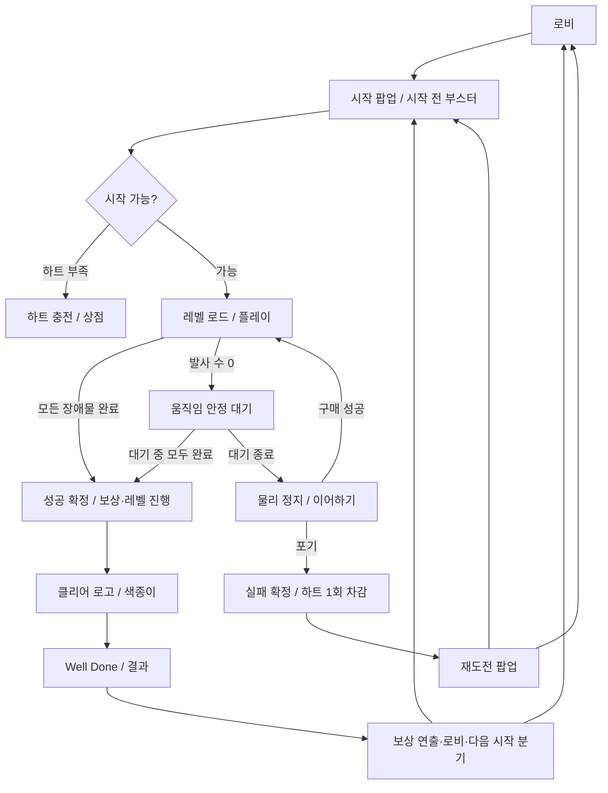

# Royal Smash — 로비·기본 규칙·UI/성공/실패 연출 구현 인계

2026-09-29. 대상은 보관된 APK/ARM64 코드다. 현재 서비스의 서버 설정이나 실기 동작을 전부 검증한 문서가 아니다. Unity 프로젝트는 수정하지 않았다.

**바로 구현할 범위:** 로비 → 시작 팝업 → 플레이 → 발사 소진/이어하기 또는 성공 → 결과 → 로비 흐름, 하트/코인/부스터 기본값, 팝업 애니메이션과 클리어 타이밍. 이벤트·광고·결제·서버 저장은 어댑터 경계로 둔다.

## 자료 읽는 순서

1. 이 문서: 규칙과 함정, 코드 근거.
2. `system_values.json`: 파일+pathID로 식별한 원본 저장값. 변수·팝업·부스터 참조 포함.
3. `ui_animation_values.json`: 노드별 Tween 값, 커스텀 커브 키/접선/가중치. `scene_node_inventory.json`에서 같은 파일의 Transform/RectTransform을 결합한다.
4. `IMPLEMENTATION_CHECKLIST.md`: 구현 순서와 재현 시험.
5. `asset_values.json`: 원시 바이트, 필드별 byte offset, 참조 파일 해석. `method_index.json` → `disassembly/` 또는 문자열 보강 `annotated/`로 코드 확인.

근거 등급은 **[원작값]** = 저장 바이트, **[원작 코드 판독]** = 이 빌드 명령/분기, **[자체]** = 권장 구현/계산이다. 설정 fallback은 코드에서 확인됐어도 실제 서버 적용값과 다르다. RVA와 파일 오프셋은 `method_index.json`에 각각 있다. 필드 메모리 오프셋을 파일 오프셋으로 사용하면 안 된다.

## 1. 화면과 상태 흐름

위 순서도는 [자체] 구현 요약이다. 재도전/다음 시작의 모든 원본 분기를 이 그림 하나로 대체하지 않는다.

- [원작 코드 판독] 로비 `LevelStartButton.OnButtonClick` **0x3957648**은 `ShowPlayPopup(true,false)`를 호출한다. 즉 로비 버튼과 실제 게임 시작을 분리한다.
- `PlayPopup.OnActionButtonClicked` **0x395ED5C**는 lives 변수 > 0이면 입력을 막고 StartGame, 아니면 AddLives 창을 연다. LifeService의 unlimited/disabled 예외와 이 UI 변수 동기화는 별도 확인 대상이다. 임의로 모든 시작 경로가 같은 조건이라고 단정하지 않는다.
- [원작값] level1#5771 시작 팝업, #5765 재도전, #6498 일반 포기, #5119 이벤트 경고 포기, #6028 인게임 설정. 노드 경로/버튼 참조는 JSON에 있다.
- 하단 탭은 Shop/Home/Leaderboard 메서드가 있다(**0x38070CC / 0x38071E0 / 0x38072F4**). `m_selectedSettingsView`라는 필드명만 보고 세 번째 탭을 설정으로 만들면 안 된다. 로비 설정 버튼은 별도로 존재한다.
- `HandleWellDoneContinueAsync` **0x39BD734**에는 로비 표시, 레벨 종료 보상 연출, 플레이 팝업 표시 또는 StartGame 분기가 있다. `ShowPlayPopupAfterLevelLimit` **0x39B2BAC**의 실제 직렬화 값은 이번에 안전하게 해독하지 못했다. **항상 로비/항상 자동 다음 레벨 중 하나로 원작값을 단정하지 않는다.** 데모 정책을 택하면 [자체]로 적는다.

## 2. 저장 상태와 하트

| 저장 변수 | 기본값 [원작값] | 용도/주의 |
|---|---:|---|
| Int_CurrentLevel | 1 | 다음 플레이 레벨 |
| Int_Coin | 1500 | 원본 기본값; 기존 유저 잔액을 덮어쓰지 않음 |
| Int_LivesCount | 5 | 저장 min=0, max=5 |
| Int_LivesPrice | 900 | 하트 충전 비용 |
| Int_CurrentLevelFailCount | 0 | 현재 레벨 실패 누적 |
| Int_FailCount | 0 | 전체 실패 변수와 구분 |
| Int_RawWinStreak / Int_WinStreakCount | 0 / 0 | 후자는 저장 min=0, max=5 |
| Int_ConsecutiveWinCount | 0 | 이벤트 연승과 기본 연승을 혼용하지 않음 |
| Int_Booster_Barrage / BigCannon / InfiniteMoves | 각각 3 | 초기 보유량 |

모든 출처는 sharedassets0.assets; 정확한 pathID와 persistent/config/sync 플래그는 JSON 참조. Int_RemainingMoves 기본 1은 실제 레벨 발사 수가 아니다. 로드 시 레벨 데이터 moves로 교체한다(LoadLevelAsync **0x39A4898**, 로드/저장 명령 **0x39A595C–0x39A5968**).

[원작 코드 판독] LifeService:

- `BeginLevel` **0x39A66C0**은 시도 상태를 초기화한다. **시작할 때 하트를 먼저 차감하지 않는다.**
- `OnWon` **0x39A99D4**는 승리 상태를 기록한다.
- `OnFailed` **0x39A99E4**, `OnQuit` **0x39A9B28**은 연승을 리셋하고 LoseLife를 호출한다.
- `LoseLife` **0x39A9A1C**는 livesEnabled, unlimited, 이미 승리/이미 차감 여부, 현재 하트를 검사한다. 유효한 패배/포기에 1회만 차감한다.
- 설정 fallback: `lives_enabled=true` (**0x39A8760**), `max_lives=5` (**0x39A87EC**), `life_regen_minutes=30` (**0x39A8878**). **서버 실값은 미확보.**
- `Regenerate` **0x39A948C**는 누적된 타이머 반복 수로 회복하며 full/unlimited 상태를 처리한다. 매 프레임 임의 30분 타이머를 새로 시작하면 안 된다.
- AddLives 액션 **0x3937EBC**: unlimited/이미 full이면 구매 없이 닫는 경로, 그 외 TrySpend → 성공 시 RefillLives(**0x393809C**)로 MaxLives까지 충전; 부족하면 상점.
- AppQuitGuard 선언/코드는 포함했으나 강제 종료 복구의 전체 시간/동기화 정책은 확정하지 않았다.

## 3. 발사, 승리, 실패 대기

[원작 코드 판독] `NotifyMoveUsed` **0x39919BC**: 종료된 시도는 무시. 일반 발사는 1 감소. 무한 발사 활성 시 감소하지 않으며, pending 상태의 **첫 발사 시점**에 종료 시간을 잡는다. 무한 발사 버튼을 누른 순간부터 3초를 소모시키지 않는다(`GrantInfiniteMoves` **0x3998774**).

`NotifyGroundHit` **0x39A0EC8**: 완료 개수를 늘리고 전체 개수 이상이면서 failPending이 아니면 성공 처리. 이 메서드 자체에는 장애물 ID 중복 제거가 없다. [자체] 이식의 장애물 보고 경로에서 중복 보고를 막아야 한다.

[원작값] LevelController level2#130:

| 항목 | 값 |
|---|---:|
| MinSettleDelay | 0.5초 |
| SettleHoldTime | 0.5초 |
| MaxSettleTime | 2초 |
| SettleLinearThreshold | 0.1 |
| SettleAngularThreshold | 0.2 |
| KillY | 0 |
| SuccessUiDelay | 0.75초 |

대기 coroutine **0x39A6BD0**: 최소 대기 후 안정 여부를 검사, 안정이 연속 hold시간에 도달하거나 최대 대기 종료 시 이어하기 창. 대기 중 성공했다면 실패 창을 띄우지 않는다.

**주의:** `AreObstaclesSettled` **0x39A2C90**는 단순 Rigidbody 속도 임계값 비교가 아니다. 위치 허용차에 threshold×hold(0.05)를 쓰고, sleeping/접촉 상태, 아래 받침 SphereCast, 받침 상대 좌표의 위치/회전 앵커를 처리한다. 움직이는 받침은 FramePosition/FrameRotation 기준이다. 각도 helper의 단위와 모든 특수 분기는 추가 이식 검토가 필요하다. 원본 메서드를 제공했으며, 속도 비교로 간소화하면 [자체]로 표시한다.

이어하기 단계는 **최종 실패가 아니다**. `PausePhysicsForFail` **0x39A2AE8**는 기존 Physics.simulationMode를 보관하고 숫자 2 모드로 바꾼다. 이 메서드는 Time.timeScale=0을 쓰지 않는다. 팝업/코루틴까지 멈추는 일괄 일시정지로 치환하지 않는다.

`OnAddMovesFailed` **0x39A2370**에서 최종 실패, Life/Stats 처리, 연승 리셋과 실패 UI 흐름이 확정된다. `MovesPurchasedEvent` **0x39A3928**는 failPending 해제, 물리 복원, 발사 수 가산, cannon/ball 복구를 담당한다. 이어하기마다 하트를 차감하면 안 된다.

## 4. 이어하기: 가격과 제공 발사 수는 서로 다른 축

[원작값] AddMovesPopup level1#5887: prices=[900,1900,3900], counts=[5,10,15,20,25,30], tierFirstFail=[1,4,8].

| 현재 시도에서 코인 이어하기를 이미 산 횟수 | 다음 가격 |
|---:|---:|
| 0 | 900 |
| 1 | 1900 |
| 2 이상 | 3900 |

| 현재 레벨의 이번 실패 순번 = CurrentLevelFailCount+1 | 추가 발사 수 |
|---:|---:|
| 1–3 | 5 |
| 4–7 | 10 |
| 8 이상 | 15 |

PriceIndex **0x3953B44**, MoveTierIndex **0x3953028**. **같은 시도에서 연속 구매한다고 +5→+10→+15가 되는 것이 아니다.** counts에 20/25/30이 저장돼 있어도 현재 tier 경계는 세 개뿐이라 이 설정에서 도달하지 않는다.

광고 이어하기는 별도 경로다. enabled 키 `addmoves_rewarded_ad_enabled`는 코드 fallback false(**0x3952408**). 저장 보상 3회 발사, 24시간/3회 관련 제한은 일반 코인 가격표와 분리한다. 광고 성공·취소·재시도 및 서버 정책 전체 검증은 남아 있다. 데모에서 광고 성공을 자동 보상으로 위장하지 않는다.

## 5. 보상과 연승

[원작값] sharedassets2.assets#79 LevelRewardConfig: Normal=15, Hard=40, SuperHard=50 코인.

[원작 코드 판독] `TriggerSuccess` **0x39A106C** → `OnSuccessDecided` **0x399DD4C**. 완료 레벨을 캡처하고 `GiveLevelReward` **0x399D938** 후 진행 레벨을 증가시킨다(호출 **0x399DF64 / 0x399DF6C**). **결과 화면 버튼에 기본 보상 지급을 다시 달지 않는다.**

DoubleReward **0x399DAA4**는 이미 받은 기본 보상에 LastReward만큼 추가, TripleReward **0x399DB80**는 2×LastReward 추가다. 호출자 resolved 가드 없이 여러 번 부르면 중복 위험이 있다. SuccessPopup의 저장 doubleRewardFromCompletedLevel=11은 다른 광고/기능 조건을 제거하는 뜻이 아니다.

연승 feature fallback true(**0x380CCE4**), 로드 중 WinStreak>=5 조건(**0x39A4BF0**)이 있다. 발사 보너스는 **+3**으로 확인:

- 애니메이션 경로 `WinStreakAnimator.<IncrementMoves>.MoveNext` **0x380C994**: 카운터 0부터 3 미만까지, 매회 +1(**0x380CA04 / 0x380CA34**).
- 애니메이터 부재 fallback **0x39A61D4**도 ADD #3.
- 문자열 로그의 “+5 moves”는 명령과 다르다. **로그를 수치 근거로 사용하지 않는다.**

### 연승 조건 추가 판독 — bmum3kax7-4 회신

**“이어하기 0회로 클리어해야 연승” 조건은 확인된 원본 분기와 다르다.** 세 카운터를 구분한다.

1. RawWinStreak: `StatsService.OnLevelWon` **0x39B22F0**은 m_inLevel 가드 후 무조건 +1(**0x39B2364**), 최장 연승 갱신, 현재 레벨 failCount=0. play-on 횟수 조건이 없다. 최종 실패 **0x39B2434**는 raw streak=0 및 실패 수 증가.
2. FirstTryWinCount: 같은 OnLevelWon 안에서 **m_attemptNumber==1일 때만** 별도로 +1(**0x39B23C8–0x39B23F4**). BeginLevel **0x39A66D4**는 저장 stats_attempt_level이 같은 레벨이면 stats_attempt_count+1, 다른 레벨이면 1로 설정. 이어하기 구매 횟수와 다른 수치다. 실패 후 재시작은 attempt 2가 된다.
3. +3 보너스용 Int_WinStreakCount: `SuccessPopup.OnEnable` **0x3969B94**에서 feature enabled이고 **m_currentLevel>=36**이면 min(old+1,5) 저장(**0x3969DC4–0x3969E24**). 이 currentLevel은 성공 시 이미 증가한 값이므로 정상 순서라면 레벨35 완료 후부터 누적. 여기에도 firstTry/play-on 조건은 없다. 최종 실패/포기의 LifeService가 0으로 리셋한다.

[자체] 원본처럼 Popup.OnEnable에 증가를 그대로 복사하면 창 재오픈 시 중복 증가 위험이 있다. 이식에서는 시도별 1회 적용을 보장하되, 위 해금/증가 조건을 유지한다. RawWinStreak와 보너스 WinStreakCount를 하나로 합치지 않는다.

## 6. 부스터 기본값

[원작값] sharedassets1.assets#2189~2192:

| 부스터 | 자원 type | 기본 보유 | 구매 1개 가격 | 핵심 저장값 |
|---|---:|---:|---:|---|
| BigBall | 2 | 3 | 700 | cannonScale 1.5, postFireHold 0.5초 |
| InfiniteMoves | 3 | 3 | 1500 | duration 3초, fillUp 0.2초, tick 0.25초, 마지막 1초 tick 0.125초 |
| Barrage | 7 | 3 | 500 | 3발, unlockLevel 26, launchStagger 0.08초, settle 0.6초 |

BigBall/Infinite ScriptableObject의 m_unlockLevel은 0이다. 기존 HUD 해금 조건(18/22)과 서로 다른 계층이므로 SO 값만으로 UI를 즉시 해금하지 않는다. Barrage는 시작/재도전 팝업의 PreLevelBoosterToggle이 참조한다. 폭발 수치/피드백/PPtr도 JSON에 있다. 일반 Int_BoostersPrice=2900을 이 구매표 대신 쓰지 않는다.

## 7. 클리어 연출 타임라인

[원작값] level1#5692: animationDuration=1.5, confettiStartDelay=0.8, inputBlockerDuration=0.5. 로고 GameObject#62, ParticleSystem#2045/#2100.

| 성공 확정 기준 시각 [자체 계산] | 원본 동작 |
|---:|---|
| 0.00초 | 보상·진행 확정, 대포 입력 종료 |
| 0.75초 | 로고 팝업 표시 |
| 1.25초 | 로고 탭 스킵 허용 |
| 1.55초 | 아직 같은 실행이면 색종이 2개 재생 |
| 3.30초 | 스킵하지 않았다면 로고 종료 → Well Done |

근거: DelayedSuccessUi **0x39A6970**, OnEnter **0x3956DDC**, 입력 해제 **0x39572DC**, ExitPopup **0x39568EC**. 자동 종료 대기는 **0.8 + (1.5×1.5−0.5)=2.55초(로고 기준)**다. m_animationDuration=1.5를 팝업 전체 수명으로 오해하면 안 된다. 프레임 스케줄링에 따른 오차가 있으며 실측 타임스탬프는 아니다.

실행별 runId/종료 1회 가드가 있다. 중간에 스킵하면 늦게 깨어난 confetti/종료 비동기 작업을 무효화한다. ExitPopup은 particles 정지, 로고/팝업 숨김, ShowWellDone, LevelSuccessEvent 1회 발행을 수행한다.

SuccessPopup level1#6425는 입력 잠금 0.25초. `OnActionButtonClicked` **0x396AA5C**는 unscaled 시간/중복 상태를 검사하고 UIController로 계속 진행을 넘긴다. 기본 코인을 여기서 다시 지급하지 않는다. 실제 WellDone 시퀀스의 이벤트·보상 수집 연출 조합은 별도 queue 경계다.

Success 캔버스 추가 순서 [원작 코드 판독]: OnEnable은 이전 reveal 상태 복원 → x3 particle 숨김 → 입력 잠금 → **LastReward를 보상 텍스트에 즉시 표시** → RewardMultiplierAnimator.ResetVisuals → 연승/해금/광고버튼 갱신 → PlayEnter. 기본 보상이 항상 0부터 카운트업한다는 근거는 없다.

Spine track 0: `PlayEnter` **0x396A5B8**는 `1_LevelEnd_DiceGuardian_Enter`(loop=false), 완료 콜백 **0x396A8A0**에서 해당 이름을 확인한 후 `2_LevelEnd_DiceGuardian_Idle`(loop=true). `PlayExit` **0x396A82C**는 `3_LevelEnd_DiceGuardian_Exit`(loop=false). 클립 길이는 이번 자료에서 확정하지 않았으므로 임의 초수 대신 완료 콜백을 사용한다. 배수 광고 뒤의 RewardMultiplierAnimator는 기본 보상 텍스트 설정과 별도다. 해당 카운트업 전체 곡선/시간은 미확정이다.

## 8. 팝업·메뉴·실패 연출

`ui_animation_values.json`의 node_path로 타깃을 결합한다. 저장된 StartFromFixedState, In/OutDelay, Loop, Broadcast, On* 이벤트도 보존한다. ScaleAnimation은 UseGerpInterpolation까지 추출했다.

- 일반 팝업 패널 예: 진입 0.3초, InValue(0,0), OutValue(0,-150), OutDuration 0. **AllowCustomInEase=true인 경우 InEase 열거형만 가져오면 틀린다.** 커브 sharedassets1#2219 `OutBackSmooth_1_03`(128 samples)의 키/접선/가중치도 제공한다.
- 로비 상단/우측/하단 진입 애니메이션은 개별 1초 설정이 있다. 정확한 좌표는 각 RectTransform·애니메이션 레코드를 사용한다. 해상도와 상관없이 픽셀 좌표만 복제하지 않는다.
- WellDoneTitleIn/Out, IntroPopUpTitle, 보상 아이콘 이동·스케일, AddMoves 배지 X/Y 커브도 추출했다. 전체 커브 13종. 커브 자산 존재가 모든 실행 경로에서 사용된다는 뜻은 아니다.

이어하기 구매 종료 `PlayPurchaseExitAsync` **0x3955AA0**: 상태 복원 → 종료 중 가드 → overlay/coin 애니메이션 시작 → 첫 패널 Out 완료 대기 → 두 번째 패널 Out 완료 대기 → 상태 복원/Close. 도중 닫힘 가드가 있다.

| level1 애니메이션 pathID | 저장값 [원작값] |
|---|---|
| 6255 첫 패널 | OutValue=(0,0), OutDuration=0.12 |
| 6256 하강 | InValue=(0,60), OutValue=(0,-2600), OutDuration=0.35 |
| 6257 배경 알파 | 약 0.9843→0, OutDuration=0.47 |
| 6258 코인 UI | (229.24,-176)→(-250,-176), OutDuration=0.3 |

첫 패널 툴팁은 (0,60) 상승을 설명하지만 저장 OutValue는 (0,0)이다. 위 coroutine에서 그 값을 60으로 재설정하는 직접 쓰기는 확인하지 못했다. **60으로 고쳐 넣지 말고 저장값/실제 타깃 위치를 함께 적용한 뒤 재생 검증**한다. 가상 호출의 모든 부수 효과까지 부정하는 판독은 아니다.

실패는 발사 소진 순간 바로 큰 실패 배너를 띄우는 흐름으로 만들지 않는다. 안정 대기 → 이어하기 → 포기/최종 실패 → TryAgain가 기본이다. 일반/이벤트 경고 캔버스를 중복 띄우지 않는다. 별도 패배 캐릭터 애니메이션이나 새 조준선은 이번 자료로 확인되지 않았으므로 원작 연출처럼 추가하지 않는다.

## 9. 검증 범위와 남은 경계

- 134개 수집 레코드 모두 바이트 끝까지 해독; 참조로 다시 읽힌 중복은 canonical file+pathID로 제거한 별도 JSON 제공. 이것은 선택한 클래스의 직렬화 검증이며, 게임 전체 에셋/UI 완전 추출을 뜻하지 않는다.
- 일부 메서드는 근거 탐색을 위해 함께 추출했을 뿐 전부 의미 검토한 것은 아니다. 본문에서 설명한 메서드/분기와 구분한다.
- 원본 UIController/SettingsToggleButton 직렬화는 상속/런타임 필드 때문에 안전하지 않아 저장값 표에서 제외했다. 추정 해독을 확정값으로 넣지 않았다.
- 미결: 로비↔다음 레벨 임계값, 강제 종료 복구 전체 정책, 이벤트 우선순위, 광고/결제 콜백·서버 잔액 권위, 모든 사운드/파티클 리소스 이식, 안정 판정 회전 helper/특수 물체 분기, 무한 하트와 PlayPopup 변수 동기화.
- [자체] 위 미결은 인터페이스·설정으로 분리하고 데모 동작은 자체값으로 표기한다. 기본 규칙과 연출을 먼저 구현할 수 있으며 원작 전체 복제 검증 완료라고 쓰지 않는다.
