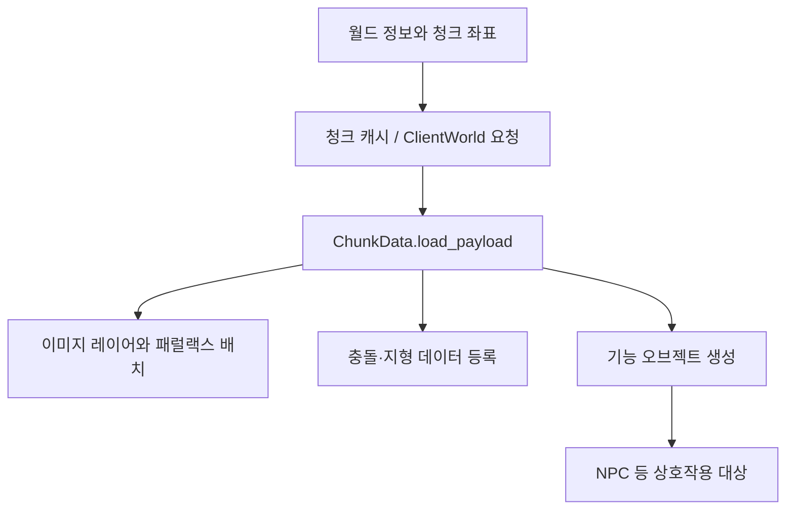

# Soulbound 맵 제작·배치 방식

조사일: 2026-09-30. 대상은 로컬 Steam 설치본이다. **고정 룸, 실행 중 불러오는 월드 청크, 설정에 따른 던전 방 조합이 공존한다.** 맵 전체를 하나의 이미지나 레벨별 프리팹으로 저장하는 구조로 보면 맞지 않는다.

근거 표기: **[저장값]** 파일에 실제 저장된 데이터, **[코드 판독]** 네이티브 코드의 참조·호출, **[해석]** 이를 연결한 설명. 서버 운영 맵과 제작 도구 원본은 확보하지 않았다. 아래 주소는 Soulbound.exe의 RVA이며 이미지 베이스는 `0x140000000`이다.

## 1. 설치본에 저장된 고정 룸

[저장값] ROOM 24개에 인스턴스 1,305개, 레이어 306개, 타일 레이어 123개가 있다. 타일 격자 6,223,022칸은 빈 칸도 포함한 수치다. 타일셋 10종의 셀 크기는 8·16·32픽셀이다. `tCollision`, `tPVPSpecialCollision`과 시각용 타일셋이 별도로 존재한다.

예를 들어 `rCFMapMain_V2`는 3072×2304, 인스턴스 399개, 레이어 30개다. `rDevRoom*`, `rDCTest*` 이름도 다수 있다. **24개는 서비스 전체 맵 수가 아니다.** `rWorld`는 저장 상태에서 400×400, 인스턴스 0개, 레이어 2개다.

이 경로에서는 배경·타일·오브젝트의 위치와 레이어를 미리 저장한다. 다만 배포된 ROOM 데이터를 읽었다는 사실만으로 원본 편집 프로젝트나 사용한 외부 편집기까지 복원한 것은 아니다.

- [전체 룸 데이터](rooms.json), [타일셋](tilesets.json)
- [24개 룸 배치 구조도](rooms_overview.png), [탐색기](Soulbound_systems.html)

구조도 색은 타일 ID를 구별하기 위한 임의 색이고 금색 점은 저장 인스턴스다. 실제 아트 합성 화면이 아니다.

## 2. 오픈월드는 청크 단위 데이터로 조립

[코드 판독] `ClientWorld.get_chunk`(RVA `0x57f9b0`)와 `WorldCache.fetch_chunk_from_api`(`0x5a48f30`)가 있다. 후자는 `clients.world.get_chunk`, 요청 중 상태, 콜백, 재시도 상태를 참조한다. `ChunkData.load_payload`(`0x47ed40`)는 받은 데이터의 시각 레이어·충돌·지형·기능 오브젝트를 별도로 처리한다.



| 데이터 | 확인한 필드 | 판독 RVA |
|---|---|---|
| Chunk | worldId, coordinates, layers, features, collisionsB64, terrainB64, collisionObjects, parallaxOrigin | `0x372e920` |
| ChunkLayer | layerId, dx/dy/dz, imageData, imageHash, layerHash, shadowObjects, zRef, frameTimes, parallax | `0x373ba20` |
| ChunkFeature | featureId, type, name, coordinates, dimensions, shape, properties | `0x3735040` |
| ChunkObjectShape | objectType, coordinates, dimensions, shape, rotation | `0x3742750` |
| WorldMetadata | worldId, displayName, buildingPlots, chunkBounds, mapBounds, audioSettings, tilingSettings, parentWorldId, tags, maxPlayers | `0x37d3ac0` |
| WorldTilingSettings | biome, biomeEdge, edges | `0x37e43e0` |

필드는 수신 변환 코드의 참조 목록이다. 모든 필드의 자료형·필수 여부·기본값까지 검증한 프로토콜 명세는 아니다.

시각 배치는 `spawn_one_layer_visual`(`0x4835c0`)이 world_x/world_y와 dx/dy, dz/z_ref를 참조한다. 기능 오브젝트는 `spawn_one_feature`(`0x481f10`)의 `feature_spawn` 경로를 사용한다. 충돌은 `collisions_b_64`, 지형은 `terrain_b_64`, 추가 형태는 `collision_objects`로 분리된다. **배경 이미지가 있다고 충돌이나 NPC 위치까지 복원되는 것은 아니다.**

[저장값] 문자열에는 아래 캐시 경로 양식도 있다. 해당 경로의 실제 운영 파일은 이번 조사에서 확보하지 못했다.

```text
world/chunks/{0}.json
world/world_and_map/{0}.json
world/chunk_index/{0}.json
world/node_sprites/{0}.json
world/map_tiles/{0}.png
world/map_features/{0}.json
world/disk_cache_version.txt
```

## 3. 던전은 방 후보·가중치·진행 조건을 조합

[코드 판독] `DCLayoutGenerator.generate`(`0x5382fe0`)는 cycle_length, cycle_order, rooms, subrooms, weighting, gating, conditional, room_weightings_array, cycle_repeat_count를 참조한다. `load_rooms`(`0x537f600`)는 JSON 파싱, `export_rooms`(`0x537f7d0`)는 JSON 직렬화를 사용한다.

- `add_room_type`(`0x537e360`): 방 유형과 주기별 구성.
- `DCRoomType.add_room`(`0x5388ca0`): 하위 방과 가중치 배열·합계.
- `set_weighting`(`0x5389e10`), gating(`0x538a020`), conditional(`0x538a220`): 선택 제약 관련 경로.

[해석] 미리 정의한 방 후보를 진행 순서·조건·가중치로 조합하는 방식이다. **모든 벽과 지형을 매번 절차 생성한다는 증거는 아니다.** `TestWorldProcgen` 또는 `inactive`가 붙은 함수 이름만으로 운영 중인 생성기를 확정하지 않았다.

던전의 시각 구성과 전투 스폰 규칙도 분리되어 있다. Dungeon 데이터에는 roomOrder, mapConfig, spawnerConfig, objectives, mobCaps가 있다. 웨이브에는 triggerCondition, events, timeoutInSeconds, completeOnMobsKilled, completionThreshold, totalMobCount가 있고, 개별 스폰에는 minCount/maxCount, spawnCycleInterval, spawnCycleCount, delayBeforeFirstSpawn이 있다.

## 제작 관점에서 정리

[해석] 확인된 런타임 구조를 기준으로 보면 제작 데이터는 다음과 같이 나뉜다.

1. 지형과 장식: 룸 타일 또는 청크 이미지 레이어, 깊이와 패럴랙스.
2. 이동 가능 영역: 충돌 격자·지형·형태 데이터.
3. 상호작용: 좌표와 속성을 가진 feature/NPC 등.
4. 던전 진행: 방 후보, 순서, 가중치, 진입 조건.
5. 전투 배치: 웨이브 트리거, 적 종류와 레벨, 수량, 시간 간격.

**미확인:** 실제 제작자가 쓰는 편집기가 GameMaker Room Editor인지 별도 내부 도구인지, Tiled/LDtk를 사용하는지, 청크 아트를 어떤 원본 파일에서 굽는지, 서버가 최종 방 선택을 어디까지 결정하는지. 배포 데이터와 로더는 확인했지만 제작 파이프라인 전체를 확보한 것은 아니다.

후속 복원에 필요한 것은 사용자가 정상 플레이하며 확보한 청크/던전 설정 payload 또는 실제 캐시다. 이미지 에셋만 추가 추출해서는 월드 배치·운영 가중치가 채워지지 않는다.

근거 원장: [스키마 필드 참조](schema_field_index.json), [함수 참조](function_reference_index.json), [캐시 문자열](map_cache_string_candidates.json), [검증 결과](systems_validation.json). 역어셈블 원문은 각 원장의 file 링크에 있다.
